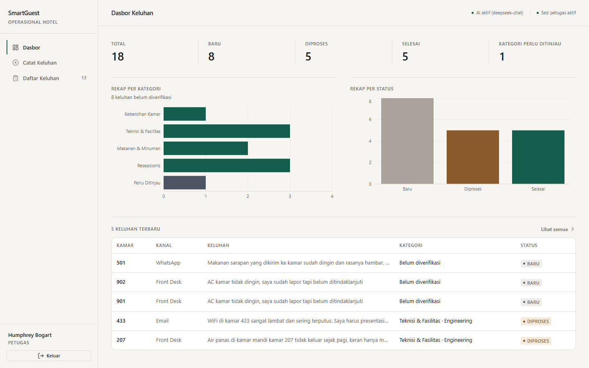

# SmartGuest Complaint

Aplikasi web untuk mencatat keluhan tamu hotel, mengklasifikasikannya dengan bantuan AI, lalu meneruskannya ke departemen yang tepat. AI hanya memberi rekomendasi; keputusan akhir tetap di tangan petugas front office.

## Masalah

Keluhan tamu masuk sebagai teks bebas lewat front desk, telepon, atau WhatsApp. Petugas harus menebak departemen yang berwenang, mencatatnya di tempat berbeda-beda, dan merekapnya secara manual. Akibatnya keluhan mudah terlewat, salah diteruskan, dan sulit ditelusuri saat hendak dievaluasi. WhatsApp di sini hanyalah label kanal yang dipilih petugas, bukan integrasi pesan.

## Solusi

SmartGuest Complaint menyatukan pencatatan keluhan, rekomendasi kategori, verifikasi petugas, penetapan departemen, dan status penanganan dalam satu alur. Prinsipnya: **AI merekomendasikan, petugas memutuskan.** Tidak ada auto-close maupun auto-assign. Status hanya berpindah lewat aksi petugas dengan urutan Baru -> Diproses -> Selesai, dan setiap aksi tercatat di jejak aktivitas.



*Dasbor: ringkasan status, rekap kategori, dan keluhan terbaru.*

## Tampilan

README ini hanya memuat gambar dasbor. Tiga tampilan utama aplikasi:

- **Dasbor ringkasan** — jumlah keluhan per status (Baru, Diproses, Selesai), jumlah per kategori, dan daftar keluhan terbaru.
- **Tabel keluhan** — daftar keluhan dengan pencarian, filter status/kategori, serta kolom kategori, departemen, dan status.
- **Panel rekomendasi** — kategori usulan AI beserta tingkat keyakinan dan alasan, yang dapat disetujui atau diubah petugas saat verifikasi.

## Fitur

1. **Catat keluhan** — teks bebas, nama tamu, nomor kamar, dan kanal masuk.
2. **Klasifikasi otomatis 5 kategori** — memakai AI bila dikonfigurasi, atau aturan kata kunci sebagai cadangan.
3. **Verifikasi petugas** — petugas menyetujui atau mengubah kategori, disertai alasan perubahan bila ada.
4. **Penentuan departemen** — ditetapkan otomatis dari kategori saat verifikasi.
5. **Status Baru / Diproses / Selesai** — transisi dibatasi dan hanya lewat aksi petugas.
6. **Ringkasan keluhan** — agregat jumlah per status dan kategori di dasbor.

Jejak aktivitas mencatat siapa yang memverifikasi, kapan, kategori dan departemen apa yang ditetapkan, serta perubahan status berikutnya.

## Kategori dan departemen

| Kategori | Departemen |
| --- | --- |
| Kebersihan Kamar | Housekeeping |
| Teknisi & Fasilitas | Engineering |
| Makanan & Minuman | F&B |
| Resepsionis | Front Office |
| Perlu Ditinjau | Duty Manager |

Pemetaan ini tetap dan dipakai otomatis saat petugas memverifikasi keluhan.

## Menjalankan

Prasyarat: Node.js >= 23.4.0. Modul `node:sqlite` tersedia tanpa flag sejak v23.4.0 (dan v22.13.0), jadi versi ini dipilih sebagai batas aman; Node 24/26 direkomendasikan karena Node 23 bukan LTS.

```bash
cd app
npm install
# salin app/.env.example menjadi app/.env, lalu isi bila memakai AI
npm run dev
```

Buka `http://localhost:3000`, lalu login dengan `staff@smartguest.local` / `password`.

Semua konfigurasi bersifat opsional; lihat [Variabel Lingkungan](#variabel-lingkungan).

## Dependensi

### Kebutuhan sistem

| Kebutuhan | Versi | Keterangan |
| --- | --- | --- |
| Node.js | >= 23.4.0 | Wajib. Aplikasi memakai modul bawaan `node:sqlite`, yang tersedia tanpa flag sejak v23.4.0 (dan v22.13.0); versi ini dipilih sebagai batas aman. Node 24/26 direkomendasikan karena Node 23 bukan LTS. |
| npm | ikut terpasang bersama Node.js | Dipakai untuk `npm install` dan menjalankan skrip di `app/`. |
| Docker | tidak perlu | Aplikasi berjalan langsung di localhost tanpa kontainer. |
| Server database (MySQL/PostgreSQL) | tidak perlu | Data disimpan di satu file SQLite lokal. |
| Layanan cloud | tidak perlu | Tidak ada dependensi layanan eksternal; LLM bersifat opsional. |

### Paket runtime dan pengembangan

Daftar diambil dari `app/package.json`; versi ditulis persis seperti di file tersebut.

| Paket | Versi | Untuk apa di proyek ini |
| --- | --- | --- |
| `next` | 16.2.6 | Framework React dan App Router, termasuk route API di `app/src/app/api`. |
| `react` | 19.2.4 | Library UI untuk komponen halaman. |
| `react-dom` | 19.2.4 | Renderer React untuk DOM browser. |
| `recharts` | ^3.8.1 | Grafik ringkasan status dan kategori di dasbor. |
| `lucide-react` | ^1.17.0 | Ikon di antarmuka. |
| `openai` | ^6.39.1 | Klien LLM OpenAI-compatible (default DeepSeek) di `app/src/lib/ai.ts`. |
| `@tailwindcss/postcss` | ^4 | Plugin PostCSS untuk Tailwind CSS v4 di `app/postcss.config.mjs`. |
| `tailwindcss` | ^4 | Styling utility-first untuk seluruh antarmuka. |
| `typescript` | ^5 | Tipe statis dan kompilasi TypeScript. |
| `eslint` | ^9 | Linter untuk `npm run lint`. |
| `eslint-config-next` | 16.2.6 | Aturan ESLint bawaan Next.js. |
| `@types/node` | ^26 | Definisi tipe Node.js. |
| `@types/react` | ^19 | Definisi tipe React. |
| `@types/react-dom` | ^19 | Definisi tipe React DOM. |

### Dependensi opsional

| Kebutuhan | Wajib? | Keterangan |
| --- | --- | --- |
| API key DeepSeek (`AI_API_KEY`) | Opsional | Mengaktifkan klasifikasi LLM. Tanpa key, aplikasi tetap berjalan memakai aturan kata kunci deterministik. |
| Playwright | Tidak dibutuhkan | Bukan dependensi proyek dan tidak dipakai untuk menjalankan atau menguji aplikasi; tes memakai `node --test` (`app/tests/workflow.test.mjs`). |

## Variabel Lingkungan

Dibaca di sisi server dari `app/.env` atau environment proses. Semua opsional; tanpa konfigurasi apa pun aplikasi tetap berjalan.

| Variabel | Wajib/Opsional | Default | Keterangan |
| --- | --- | --- | --- |
| `AI_API_KEY` | Opsional | kosong | Kunci API DeepSeek. Bila diisi, klasifikasi memakai LLM; bila kosong, memakai aturan kata kunci. |
| `AI_BASE_URL` | Opsional | `https://api.deepseek.com` | Endpoint OpenAI-compatible untuk jalur `AI_API_KEY`. |
| `AI_MODEL` | Opsional | `deepseek-chat` | Model untuk jalur `AI_API_KEY`; saat AI tidak aktif nilainya tidak berpengaruh pada klasifikasi. |
| `OPENAI_API_KEY` | Opsional | kosong | Kompatibilitas lama; hanya dipakai bila `AI_API_KEY` kosong. |
| `OPENAI_BASE_URL` | Opsional | tidak diset (default SDK OpenAI) | Endpoint untuk jalur `OPENAI_API_KEY`. |
| `OPENAI_MODEL` | Opsional | `gpt-4o-mini` | Model untuk jalur `OPENAI_API_KEY`. |
| `SMARTGUEST_DB_PATH` | Opsional | `data/smartguest.db` relatif terhadap direktori kerja `app/` | Lokasi file SQLite. Juga dibaca `app/scripts/reset-db.js`, tetapi skrip itu tidak memuat `.env`, jadi set lewat environment saat menjalankan perintah. |
| `PORT` | Opsional | `3000` | Port server; dibaca oleh CLI Next.js (`next dev`/`next start`), bukan oleh kode aplikasi. `npm run dev:3123` menimpanya dengan `-p 3123`. |

Rujukan kode: `app/src/lib/ai.ts` (konfigurasi LLM) dan `app/src/lib/db.ts` (lokasi database).

## Mode tanpa API key

Jika `AI_API_KEY` kosong, klasifikasi memakai aturan kata kunci deterministik dan aplikasi tetap berjalan. Badge di header menunjukkan mode aktif: "AI aktif (nama model)" atau "Aturan kata kunci (AI tidak aktif)".

## Perintah

Jalankan dari direktori `app/`.

| Perintah | Fungsi |
| --- | --- |
| `npm run test` | Tes alur kerja dengan `node --test`. |
| `node scripts/test-ai-heuristics.js` | Verifikasi heuristik klasifikasi aturan kata kunci. |
| `npm run db:reset` | Hapus database SQLite lokal; dibuat ulang saat server start. |
| `npm run build && npm start` | Build produksi lalu jalankan server. |

## Struktur repo

| Path | Isi |
| --- | --- |
| `app/` | Aplikasi Next.js: UI, route API, akses SQLite, dan mesin klasifikasi. |
| `docs/` | Dokumen perencanaan dan spesifikasi. Mulai dari [`docs/README.md`](docs/README.md). |

## Catatan

- Database SQLite lokal di `app/data/`; tidak memakai Docker.
- Proyek akademik, bukan sistem produksi.
- Dataset evaluasi belum disertakan di repo, sehingga belum ada angka performa klasifikasi yang diklaim.

## Lisensi dan asal kode

Kode diadaptasi dari repo publik `jaswanthneyigapula30-ux/staysage-ai-saas`, yang tidak menyertakan berkas lisensi. Karena itu repo ini tidak mengklaim lisensi apa pun (termasuk MIT) dan hanya disediakan untuk keperluan tugas akademik.
