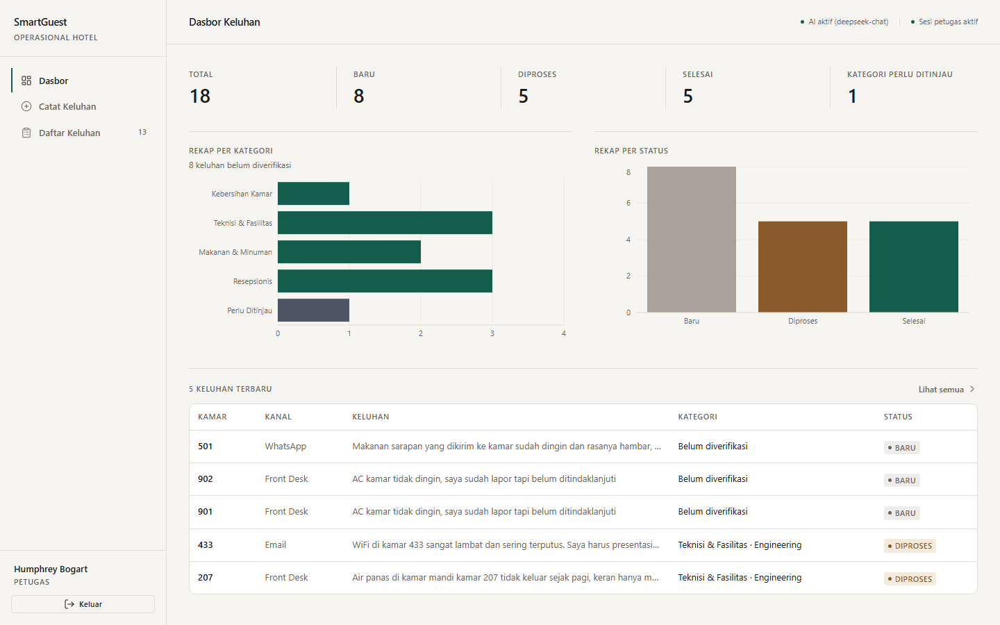
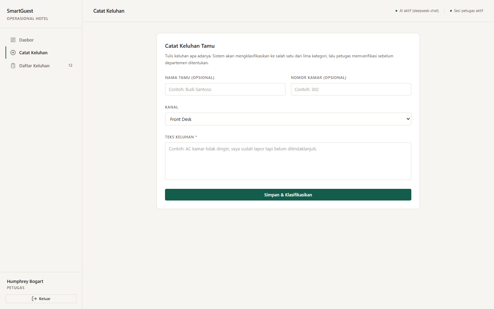
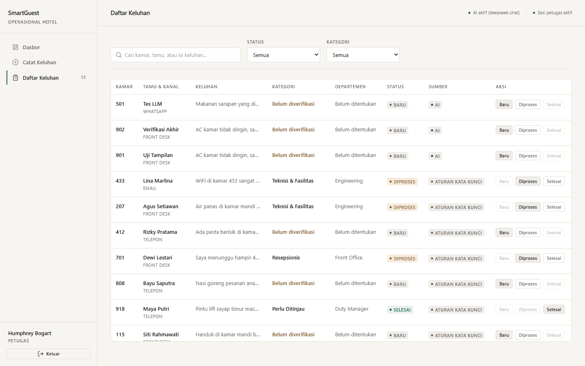
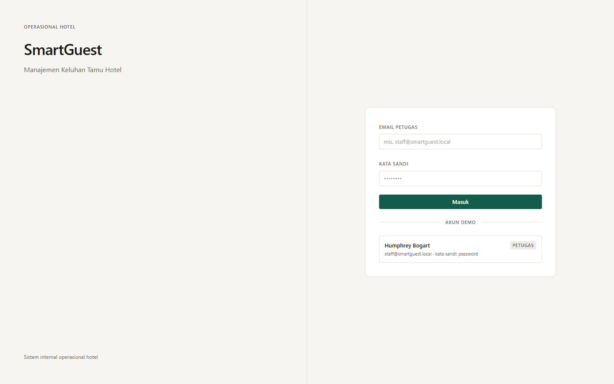

# SmartGuest

Local-first hotel complaint operations app. Runs fully offline on localhost with
a local SQLite database, local password auth and cookie sessions. Complaints are
classified into five fixed categories, verified by a staff member, then routed to
the responsible department.

## 🖥️ Application Screenshots

### 📊 Operations Dashboard


### 📝 AI Assisted Ticket Logging


### 📋 Guest Complaints Desk


### 🔐 Login


---

## 🛠️ Tech Stack

- **Framework**: Next.js 16 (App Router, TypeScript)
- **Styling**: Tailwind CSS v4
- **Icons**: Lucide React
- **Charts**: Recharts
- **Database**: SQLite via Node's built-in `node:sqlite` (`DatabaseSync`) — file at `data/smartguest.db`
- **Auth**: local `users` + `sessions` tables, `scrypt` password hashes, httpOnly session cookie
- **AI Engine**: keyword-rule analyzer by default; an OpenAI-compatible LLM only if an API key is set

No external services, cloud credentials, Docker, or native builds are required.

### Node version

`package.json` declares `"engines": { "node": ">=22.5" }`. This app relies on
Node's built-in `node:sqlite` module, which is available from Node 22.5 (behind
the then-experimental flag) and stable in newer releases. Node 22.5+ is required;
Node 24/26 are recommended.

---

## 🚀 Run from zero

```bash
cd C:/dev/apps/smartguest/app
npm install          # or: npm ci
npm run dev          # http://localhost:3000
# fixed port used for manual verification:
npm run dev:3123     # http://localhost:3123
```

Open `/login`, sign in, and the schema plus seed data are created automatically
on the first database call (`schema.sql` is executed with `CREATE TABLE IF NOT
EXISTS ...`).

### Demo account

All seeded users are treated as **Petugas** (single-role app, matching the
pitch deck). The login screen quick-login button uses:

| Email | Password |
| --- | --- |
| `staff@smartguest.local` | `password` |

The other two seeded rows (`admin@smartguest.local`, `manager@smartguest.local`,
same password) exist only as extra data. The `role` column is retained in the
database for compatibility but is not used by the UI or authorization.

### Seed data

- 3 users, all treated as Petugas
- **15** Indonesian sample complaints (AC, towels, cold food, slow check-in,
  noise, double billing, hot water, stuck elevator, closed pool, duplicate
  report, coffee station, weak WiFi, balcony lock, unfriendly reception, raw
  fried rice) with analysis rows and activity logs

Reset the local database at any time:

```bash
npm run db:reset
```

### Checks

```bash
npm run test                      # node --test tests/*.test.mjs (workflow rules)
node scripts/test-ai-heuristics.js # keyword classification cases
npm run build                     # production build
npx tsc --noEmit                  # type check only
```

---

## 💾 Database

- File: `data/smartguest.db` (git-ignored)
- Schema: [`schema.sql`](./schema.sql)
- Tables: `users`, `sessions`, `complaints`, `complaint_analysis`, `activity_logs`
- Indexes: `complaints(created_at)`, `complaints(status)`,
  `complaints(category)` (`idx_complaints_category`), `activity_logs(complaint_id)`,
  `sessions(user_id)`
- Migration: automatic on startup (no migration tool)
- Override the location with `SMARTGUEST_DB_PATH=/abs/path/db.sqlite`

## 🔐 Auth model

- Passwords: `scrypt` from `node:crypto`, stored as `scrypt$N$r$p$salt$hash`
- Sessions: random 32-byte token in the `sessions` table, sent as an `httpOnly`
  `SameSite=Lax` cookie named `smartguest_session` (7 day expiry)
- No JWT, no localStorage session
- `src/proxy.ts` (Next.js 16's renamed Middleware) gates `/` and
  `/api/complaints*`: pages redirect to `/login`, APIs return `401` JSON. Every
  complaint route re-validates the session against the `sessions` table.

## 🔄 Workflow rules

Single source of truth: `src/lib/workflow.ts`, imported by both the API routes
and the UI.

- Status order: `baru` → `diproses` → `selesai`
- Allowed transitions: `baru → diproses`, `diproses → selesai`. Skipping a step
  (`baru → selesai`), moving backwards (`selesai → baru`), or "moving" to the
  same status is rejected with `400`.
- A complaint may only become `selesai` once it has a verified `category`
  (enforced again in `db.updateStatus`).
- `department` is always derived from `category` via `CATEGORY_TO_DEPARTMENT`
  (kebersihan → housekeeping, teknisi → engineering, fnb → fnb,
  resepsionis → front_office, perlu_ditinjau → duty_manager).

## 🔌 API

| Route | Auth | Notes |
| --- | --- | --- |
| `POST /api/auth` | public | login, sets session cookie (400 for non-string email/password) |
| `GET /api/auth` | cookie | current session ("me") |
| `DELETE /api/auth` | cookie | logout, clears cookie |
| `GET /api/health` | public | `{ status, db, version }` |
| `GET /api/ai-status` | cookie | `{ configured, provider, model }` (401 without session) |
| `GET /api/complaints` | cookie | list, newest first |
| `POST /api/complaints` | cookie | create + AI analysis (201); invalid `channel` → 400 |
| `GET /api/complaints/:id` | cookie | complaint + analysis + logs |
| `PATCH /api/complaints/:id` | cookie | one of the three actions below |

### `PATCH /api/complaints/:id`

Exactly one `action` per request:

| Action | Body | Behaviour |
| --- | --- | --- |
| `accept` | `{ "action": "accept" }` | Accepts the AI recommendation, sets `category` + derived `department`, moves `baru` → `diproses`. Rejected if already finished or already verified. |
| `change` | `{ "action": "change", "category": "kebersihan", "reason": "..." }` | Changes `category`; `department` is derived automatically. If `department` is sent it must match the derived value, otherwise `400`. `reason` is required and must be at least 10 characters. |
| `status` | `{ "action": "status", "status": "diproses" }` | Transitions status using the workflow rules above. `baru` cannot jump straight to `selesai`, and `selesai` requires a verified `category`. |

## ⚙️ Environment variables

All optional. The default provider is DeepSeek.

```bash
AI_API_KEY=...                              # enables the LLM analyzer
AI_BASE_URL=https://api.deepseek.com        # OpenAI-compatible endpoint (default DeepSeek)
AI_MODEL=deepseek-chat                      # model name (default DeepSeek)
SMARTGUEST_DB_PATH=...                      # custom SQLite file path
```

Legacy `OPENAI_API_KEY` / `OPENAI_BASE_URL` / `OPENAI_MODEL` are still honoured
when `AI_API_KEY` is empty. With no key configured the app uses the deterministic
Indonesian keyword rules and everything keeps working offline (max LLM timeout is
7 seconds before falling back to the rules).
